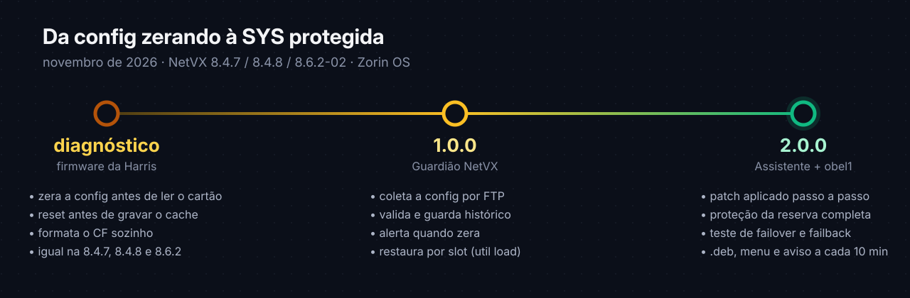
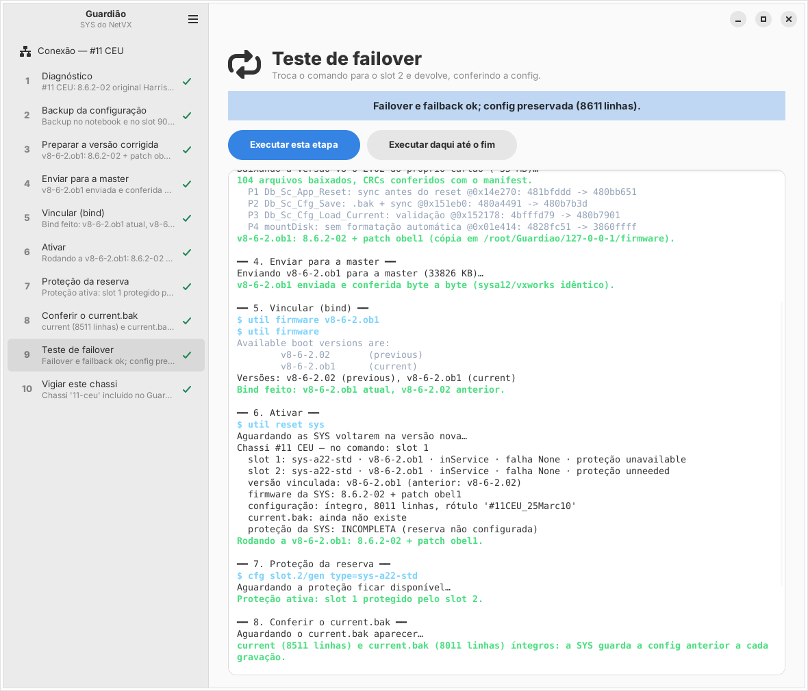

# Histórico de versões

  

Legenda:  recurso novo ·  mudança em algo que já existia ·  defeito corrigido

## 2.0.1 - 2026-11-16

**Failover na bancada com switch.** Correções depois do teste com as duas SYS e o notebook no mesmo switch.

-  O teste de failover não para mais com "Tempo esgotado: timed out". Durante a troca, a SYS fica um tempo sem responder, a sessão antiga fica muda e o FTP volta depois do telnet. O assistente espera tudo isso, sem limite fixo, e pergunta ao operador antes de desistir.
-  Com o slot 2 no comando, o assistente não diz mais "Sem proteção ativa": a proteção aparece como **em uso**, e o teste de failover faz só o failback.
-  A tela de estado não fecha mais o assistente quando a proteção está num estado novo.
-  O diagnóstico oferece o failback quando encontra o slot 2 no comando, em vez de parar.
-  Antes do failback, espera o slot 1 voltar como reserva. Se a SYS recusar, tenta de novo em 30 s, até três vezes. No fim, confere se a proteção voltou a ficar disponível.
-  Quando a SYS recusa o failover ou o failback, o assistente mostra a resposta dela (por exemplo, "No backup available").
-  O simulador ganhou o modo switch, com sessão muda, IP fora do ar, FTP atrasado e slot 1 reiniciando, e testes para retomar o failback.

## 2.0.0 - 2026-11-14

**Assistente.** O caminho que corrigiu o chassi do Morro do Céu virou um assistente gráfico passo a passo.

-  **Assistente GTK4/libadwaita** com dez etapas: diagnóstico, backup, preparar, enviar, vincular, ativar, proteção, `current.bak`, teste de failover e vigiar. Confirmação antes de tudo que pode afetar o ar.
-  **Imagem corrigida montada a partir do firmware do próprio cartão**, com conferência de CRC de cada arquivo, envio por FTP e leitura de volta byte a byte.
-  **Ativação sem queda** (reset da reserva, failover, reset do slot 1, failback) ou por reset do sistema.
-  **Proteção da reserva**: detecta a reserva encaixada mas não configurada e completa a configuração.
-  **Teste de failover e failback** conferindo que a configuração sobrevive à troca. Pede para mudar o cabo do notebook quando o IP passa para a outra SYS.
-  **Voltar à versão anterior** pelo menu.
-  **Patch obel1 para 8.4.7, 8.4.8 e 8.6.2-02**, com endereços gerados pelos símbolos da imagem (`patch-obel1/gen_versao.py`). Comando offline `guardiao patch`.
-  Pacote **`.deb`**, logo no menu e atalho na Área de Trabalho, metadados para a loja do Zorin e atualização automática pelo GitHub.
-  **Vigilância a cada 10 minutos** (timer do systemd) com aviso na área de trabalho.
-  Validação da config também exige término em `\n`, o que pega arquivo truncado. Mesmo critério dentro da SYS.
-  `util save` mantém o rótulo da config ativa. O rótulo passado ao `util save` substitui o da config em uso.
-  CRC do NetVX cerca de 100 vezes mais rápido (zlib com bits espelhados).
-  O failback é `util failback slot.1` (o slot primário), e não `slot.2` como diz o manual de 2011.
-  Simulador de NetVX (telnet + FTP) e testes ponta a ponta, inclusive com o firmware real. GitHub Actions roda os testes a cada push e cria a Release a cada tag.

## 1.0.0 - 2026-11-14

**Guardião NetVX.** Script único de vigilância.

-  Coleta por FTP de `etc/cfg`, `umconfig.txt`, `snmpd.cnf` e `brand`, com validação e histórico.
-  Alerta quando a config encolhe ou fica ilegível; restauração por slot (`util load`).
