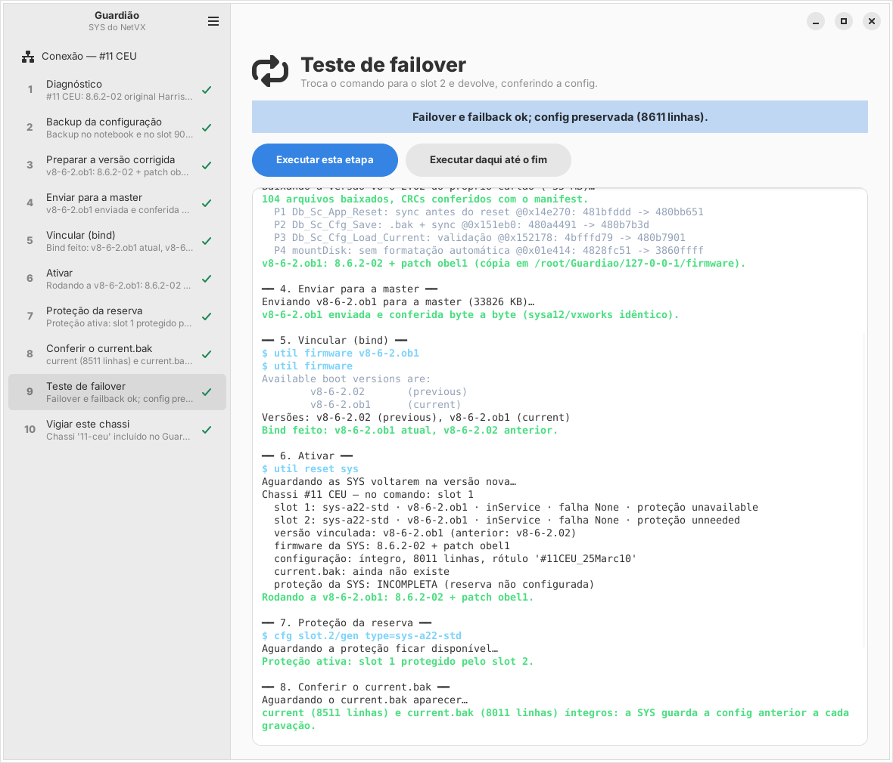
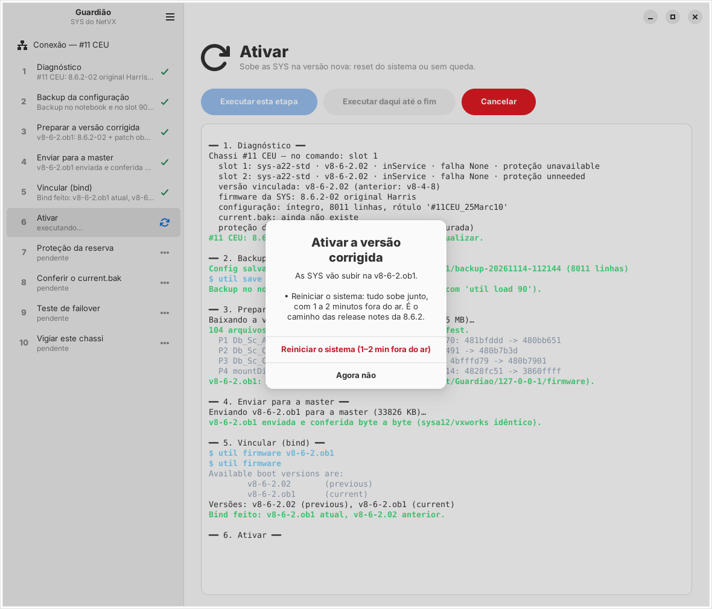
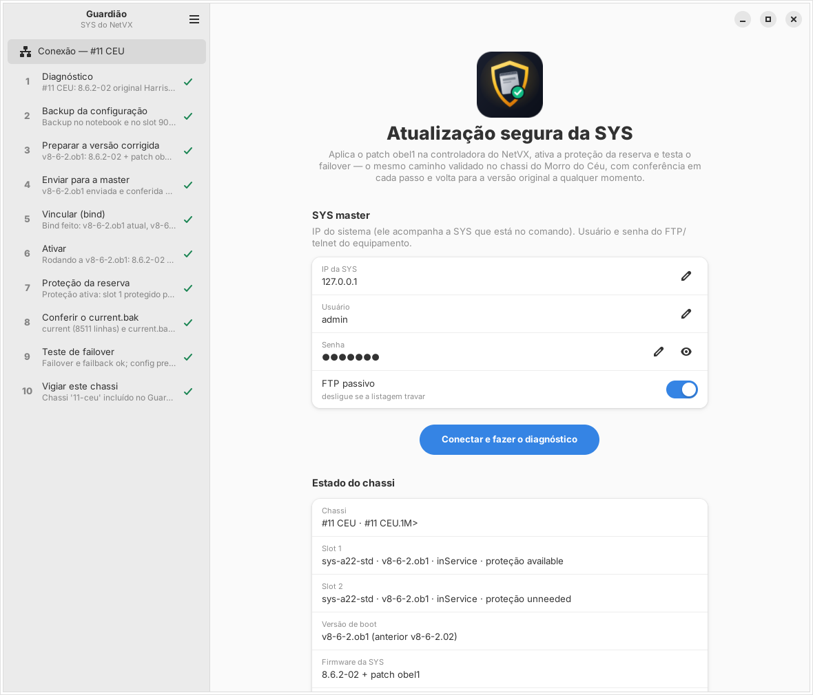

<p align="center">
  
</p>

<p align="center">
  
  
  
  
  
  
</p>

**Guardião** protege a configuração das controladoras (**SYS**) do **Harris NetVX**. Um assistente passo a passo aplica a correção **obel1** no firmware da SYS, completa a proteção da reserva e testa o failover. Depois, o Guardião confere a configuração de cada chassi a cada 10 minutos e avisa se ela se perder.

Ele nasceu de um problema de operação. Em chassis com SYS reserva, a controladora perdia a configuração gravada no cartão CompactFlash, voltava ao padrão de fábrica e ainda copiava a configuração zerada para a reserva. A análise do firmware mostrou a causa, e o mesmo código está nas versões 8.4.7, 8.4.8 e 8.6.2-02:

- a SYS apaga a configuração **antes** de ler o arquivo do cartão, sem conferir se ele está íntegro;
- grava sem garantir que os dados chegaram ao cartão;
- pede o reset do chassi antes de descarregar o cache do disco;
- formata o CF sozinha se ele não montar.

A correção foi validada no chassi do Morro do Céu em novembro de 2026: upload, bind, reset, proteção da reserva, `current.bak` e failover/failback. O assistente refaz esse caminho com conferência em cada passo.

<p align="center">
  <br>
  <sub>As dez etapas concluídas, com o registro de cada comando enviado à SYS. Capturas feitas contra o simulador de NetVX incluído nos testes.</sub>
</p>

---

## O que o assistente faz

| # | Etapa | O que acontece |
|---|---|---|
| 1 | **Diagnóstico** | Conecta na master por telnet e FTP e lê as duas SYS (`stat slot.N/gen`), as versões de boot, o firmware em uso, a integridade da config e o estado da proteção. Para se a config já estiver ruim ou se o slot 2 estiver no comando. |
| 2 | **Backup** | Copia `etc/cfg` para o notebook e grava a config num slot livre da própria SYS (`util save 90`), **mantendo o rótulo atual**. Para recuperar: `util load 90`. |
| 3 | **Preparar** | Baixa a versão em uso **do próprio cartão** (≈35 MB), confere o CRC de cada arquivo com o manifest e aplica o patch obel1 no `sysa12/vxworks`. Nenhum arquivo da Harris vem no Guardião. |
| 4 | **Enviar** | Envia por FTP como uma versão nova (`v8-6-2.ob1`) e lê a imagem de volta para comparar byte a byte. |
| 5 | **Vincular** | `util firmware v8-6-2.ob1`. A versão original vira a "anterior", que é o rollback. Não reinicia nada. |
| 6 | **Ativar** | Duas opções: **reiniciar o sistema** (1 a 2 min fora do ar) ou **sem queda**, uma controladora de cada vez (reset da reserva, failover, reset do slot 1, failback). |
| 7 | **Proteção** | Se a reserva está encaixada mas não configurada (`slot.2/gen/type=none`, o caso do Morro do Céu), configura e confere `protAvail = available`. |
| 8 | **current.bak** | Confirma que a SYS passou a guardar a config anterior a cada gravação. |
| 9 | **Failover** | Passa o comando para o slot 2, confere se a config ficou inteira e devolve com `util failback slot.1`. |
| 10 | **Vigiar** | Inclui o chassi no Guardião: coleta a cada 10 minutos e aviso na área de trabalho se a config zerar. |

Toda ação que pode afetar o ar pede confirmação. Pelo menu dá para **voltar à versão anterior** a qualquer momento: o assistente faz o bind da original e reinicia o sistema.

<p align="center">
  
  
</p>

> **Notebook ligado direto na porta da SYS?** O IP do sistema acompanha a controladora que está no comando. No failover, o assistente detecta que o IP sumiu e pede para você passar o cabo para a porta do outro slot. Com um switch no meio, nada disso é necessário.

---

## Instalação no Zorin OS

### Opção 1: pacote .deb

Baixe o `guardiao_<versão>_all.deb` em [Releases](../../releases) e dê dois cliques, ou:

```bash
sudo apt install ./guardiao_2.0.0_all.deb
```

### Opção 2: a partir do código

```bash
git clone https://github.com/aragonxpd154/guardiao.git
cd guardiao
sudo ./instalar.sh
```

### Opção 3: sem instalar

```bash
sudo apt install python3-gi gir1.2-gtk-4.0 gir1.2-adw-1
git clone https://github.com/aragonxpd154/guardiao.git && cd guardiao
./guardiao.sh
```

Depois de instalado, o **Guardião aparece com o logo no menu** e ganha um **atalho na Área de Trabalho**. O clique direito no ícone dá acesso a *Coletar agora*, *Histórico das coletas* e *Editar configuração*. Precisa do Zorin OS 18 / Ubuntu 24.04 (GTK 4.14 e libadwaita 1.5).

> Se o Zorin mostrar o atalho da Área de Trabalho com um aviso, clique com o botão direito nele e escolha **Permitir execução** (só na primeira vez).

---

## Linha de comando

| Comando | Para quê |
|---|---|
| `guardiao` | abre o assistente |
| `guardiao estado 192.168.101.20` | diagnóstico do chassi pelo terminal |
| `guardiao coletar` | coleta e valida a config de todos os chassis (o timer roda a cada 10 min) |
| `guardiao listar [chassi]` | histórico das coletas |
| `guardiao restaurar <chassi> [--snapshot ID] [--slot 9] [--carregar]` | envia uma config boa para um slot e confere; `--carregar` executa o `util load` |
| `guardiao patch <cópia do cartão> <saída>` | aplica o obel1 offline, numa cópia do cartão ou na pasta `firmware` do pacote |
| `guardiao configurar` | abre `~/.config/guardiao/guardiao.ini` (permissão 600) |
| `guardiao --atualizar` | procura versão nova no GitHub e oferece instalar |

Códigos de saída do `coletar`: `0` ok, `2` alerta (config ruim ou encolheu), `1` erro de coleta.

### O que gera alerta

- `current` ausente, vazio, sem `#cfg=`, com bytes nulos (cluster perdido no CF), menor que 64 bytes, terminando no meio de uma linha ou ilegível. São os mesmos critérios do patch obel1, que roda dentro da SYS.
- Config que encolheu mais de 30% em relação à última coleta boa: é o sintoma de "zerou as configs".

O aviso aparece na área de trabalho. Para mandar para outro lugar, use `alerta_cmd` no `guardiao.ini` (trap SNMP, ntfy, e-mail), com a mensagem em `$GUARDIAO_MSG`.

### Atualizações

Uma vez por dia, o Guardião procura versão nova em [Releases](../../releases) e pergunta antes de instalar. O pacote é conferido pelo SHA-256 publicado.

---

## Segurança do patch

- **Só imagens conhecidas:** o patch só é aplicado em imagens originais conhecidas, identificadas pelo CRC. Antes de mexer, ele confere a instrução original em cada ponto.
- **Pior caso igual ao original:** se o `current` e o `.bak` estiverem ruins, a SYS carrega o `current` como o firmware original faria.
- **Bootrom intacto:** o bootrom, os módulos e as FPGAs não são tocados, e a versão original fica no cartão como "anterior".
- **Fonte aberta:** o código novo que vai dentro da SYS está em [`patch-obel1/cave.S`](patch-obel1/cave.S), com o gerador de endereços e o teste em emulador PowerPC.
- **Detalhes técnicos:** o diagnóstico completo e o procedimento de bancada estão em [`docs/DIAGNOSTICO-E-BANCADA.md`](docs/DIAGNOSTICO-E-BANCADA.md).

## Testes

```bash
pip install pyftpdlib                         # só para o simulador
python3 -m unittest discover -s tests -v
GUARDIAO_FIRMWARE=~/copia_do_cartao python3 -m unittest discover -s tests -v   # + firmware real
```

O simulador ([`tests/simulador.py`](tests/simulador.py)) imita um chassi com duas SYS, por telnet e FTP. Ele reproduz o prompt, o `stat`, o `util firmware`, o `util save` e o `cfg` com o `protMode` somente leitura. Também simula reset, failover e failback, com as mesmas mensagens de erro da SYS real, e a troca do cabo do notebook de porta. `tests/capturas.py` gera as imagens deste README.

## Publicar uma versão nova

1. Altere `__version__` em `guardiao/__init__.py` e escreva a seção da versão no `CHANGELOG.md`.
2. `git commit -am "Guardião 2.0.1" && git tag v2.0.1 && git push origin main v2.0.1`

O GitHub Actions roda os testes, gera o `.deb` e cria a Release com o SHA-256. No dia seguinte, os Guardiões instalados oferecem a atualização.

## Estrutura

```text
guardiao/
├── guardiao/
│   ├── gui.py          assistente gráfico (GTK4 + libadwaita)
│   ├── assistente.py   as dez etapas, sem interface
│   ├── netvx.py        estado do chassi, firmware, reset, failover, proteção
│   ├── console.py      telnet com o console da SYS (sem telnetlib)
│   ├── sysftp.py       FTP com o cartão da SYS
│   ├── patch.py        patch obel1 (8.4.7, 8.4.8, 8.6.2-02)
│   ├── validacao.py    integridade da config e CRC do NetVX
│   ├── monitor.py      coleta, histórico e avisos
│   ├── config.py       ~/.config/guardiao/guardiao.ini
│   ├── cli.py · atualizacao.py · tela.py
│   └── dados/obel1/    código novo montado e endereços de cada versão
├── patch-obel1/        fonte do patch: cave.S, gerador, emulador
├── tests/              testes e simulador de NetVX
├── packaging/          .deb, atalhos, timers, ícones, metainfo
├── docs/               diagnóstico e procedimento de bancada
└── assets/             logo, banner, capturas
```

## Aviso

Projeto independente, sem vínculo com a Harris, a Imagine Communications ou a GatesAir. NetVX e VideoRunner são marcas de seus donos. Este repositório **não contém** firmware, binários nem documentação da Harris: o Guardião trabalha sobre o firmware que já está no cartão da SYS. Use por sua conta e risco e passe primeiro pela bancada (veja [`NOTICE`](NOTICE)).

## Licença

[GPL-3.0](LICENSE) © Marcos Santos
